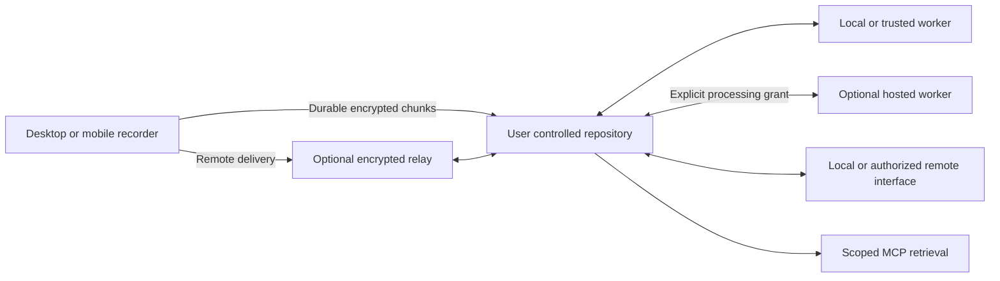

# SaidNest Architecture

SaidNest separates capture, storage, compute, and connectivity. These are the planned architecture boundaries; the deployed release is a website and sample timeline. A separate Windows development slice now connects encrypted saved recordings, experimental local inference, and an authenticated loopback timeline; see [prototype limits](WINDOWS_PROTOTYPE.md).

## Repository ownership

The owner's machine stores audio, timestamped transcripts, revisions, and search indexes. The same web interface will be available locally, over authenticated LAN access, or through an optional cloud relay. Local access must remain independent of cloud accounts and subscriptions.

## Recording and compute

Windows microphone and output capture will use separate synchronized tracks. Recording persists recoverable chunks independently of inference. Workers return provisional and finalized segments through a versioned protocol; model runtimes remain replaceable. A low-compute repository can delegate jobs to a trusted machine or explicitly authorized hosted worker.

## Connectivity and privacy

Recorders retain data until the repository acknowledges durable storage. Transfer identity and sequence numbers make reconnects resumable and duplicate-safe. The relay forwards end-to-end encrypted payloads and can observe connection metadata. Hosted transcription has a different boundary: a conventional worker decrypts only the audio assigned to its job. A hosted browser interface requires trust in the delivered application code.

## Managed service

Cloudflare Workers serves the initial interface and API. Durable Objects is the proposed relay coordinator; D1 is reserved for service metadata and R2 for optional expiring encrypted delivery buffers. Customer transcript search remains in the owner's repository. GPU inference infrastructure is a separate future selection.

The public application, worker protocol, and relay implementation remain open source. Managed connectivity subscriptions and optional compute usage pay for operated services. Subscription expiry must not prevent local archive access or export.

## MVP boundaries

The first recording release supports one owner and one authoritative repository per library, with multiple paired devices. Separate repositories remain separate libraries; automatic multi-writer replication and shared organization roles are deferred. Capture is user initiated, with explicit sources, meters, pause/stop controls, and interruption reporting. Source labels identify microphone or system output and do not identify remote participants by name.

The first hosted-compute path is authorized by an online repository. A recorder queues audio while that repository is unavailable. A conventional hosted worker receives access only to its assigned audio, never the repository master key. Cloud login and billing entitlements are separate from permission to read content.

## Identity and archive before private capture

Owner identity, archive encryption, transfer sessions, and job grants need separate lifecycles. Key custody, unlock after restart, recovery, replacement-server restore, and revocation must be decided before private recordings are stored. Recovery must not depend on a cloud support override. Pairing must verify device keys so an untrusted relay cannot silently substitute its own key.

The repository service owns database writes. Clients and workers use authenticated APIs rather than writing a shared SQLite file. A backup includes a consistent set of database records, audio chunks, and owner-controlled recovery material.

## Completion and deletion

Capture, delivery, and transcription have independent states. Stopping capture does not mean upload or inference has finished. A final manifest identifies the expected tracks and chunks; a durable acknowledgment requires both verified data and a recoverable metadata commit. Relay receipt and generated text are not proof that the archive is complete or backed up.

Deletion tombstones must reject stale recorder uploads and late worker results. Offline devices apply deletion notices on reconnection, and the interface reports pending cleanup. Retries, cancellation, quota exhaustion, protocol upgrades, and queue limits need explicit behavior before remote recording is released.

## Measurement and release gates

Measure provisional text and finalized text separately, including capture buffering and endpoint detection. Evaluate concurrent microphone/output tracks, overlap, silence, echo, drift, and failure recovery. Select the initial language scope, model, and hardware requirements using a versioned corpus rather than throughput claims alone.

The local alpha needs a clean-machine installer, offline model provisioning, backup restoration, and a release/update policy. The connected alpha needs authenticated pairing, cross-library denial, bounded queues, relay restart recovery, and measured active-stream cost. Hosted processing adds customer isolation, cancellation/retention enforcement, and spending reservations before paid jobs are accepted.

The current starter has CI checks and a manual Cloudflare deployment process. Staging, automated deployment, native release checks, and schema-migration recovery are future work. Cloudflare analytics injection is disabled on the deployed site. See the [plan review](PLAN_REVIEW.md) and [roadmap](ROADMAP.md).

## Current Windows live slice

The development implementation tails authenticated committed audio chunks with a separate worker task; no model or network call runs inside WASAPI callbacks or the writer. Each source gets a four-second draft and an eight-second final window; the final replaces its draft in the timeline. The worker uses bounded PCM windows and a replaceable pinned CLI adapter, launching a CUDA process for each decode. This is rolling batch recognition, not the final persistent streaming protocol described above. The current source windows do not overlap, so boundary wording and missing context need quality evaluation.

Immutable encrypted parts preserve draft/final history. An encrypted atomic progress checkpoint records model provenance and source progress; the final revision is committed before inference reports complete. The browser polls only active records, and reads bounded playback windows after capture stops. Authenticated stop requests become encrypted control objects. Model failure retains the independent audio archive. Automatic inference resume, human corrections, echo handling, and hour-long reliability remain open; the public cloud preview stays synthetic.