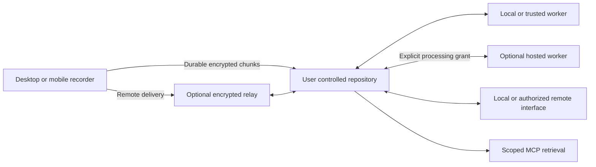

# SaidNest Architecture

SaidNest separates capture, storage, compute, and connectivity. These are the planned architecture boundaries; the first deployed release is a website and sample timeline, not the complete recording system.

## Repository ownership

The owner's machine stores audio, timestamped transcripts, revisions, and search indexes. The same web interface will be available locally, over authenticated LAN access, or through an optional cloud relay. Local access must remain independent of cloud accounts and subscriptions.

## Recording and compute

Windows microphone and output capture will use separate synchronized tracks. Recording persists recoverable chunks independently of inference. Workers return provisional and finalized segments through a versioned protocol; model runtimes remain replaceable. A low-compute repository can delegate jobs to a trusted machine or explicitly authorized hosted worker.

## Connectivity and privacy

Recorders retain data until the repository acknowledges durable storage. Transfer identity and sequence numbers make reconnects resumable and duplicate-safe. The relay forwards end-to-end encrypted payloads and can observe connection metadata. Hosted transcription has a different boundary: a conventional worker decrypts only the audio assigned to its job. A hosted browser interface requires trust in the delivered application code.

## Managed service

Cloudflare Workers serves the initial interface and API. Durable Objects is the proposed relay coordinator; D1 is reserved for service metadata and R2 for optional expiring encrypted delivery buffers. Customer transcript search remains in the owner's repository. GPU inference infrastructure is a separate future selection.

The public application, worker protocol, and relay implementation remain open source. Managed connectivity subscriptions and optional compute usage pay for operated services. Subscription expiry must not prevent local archive access or export.
